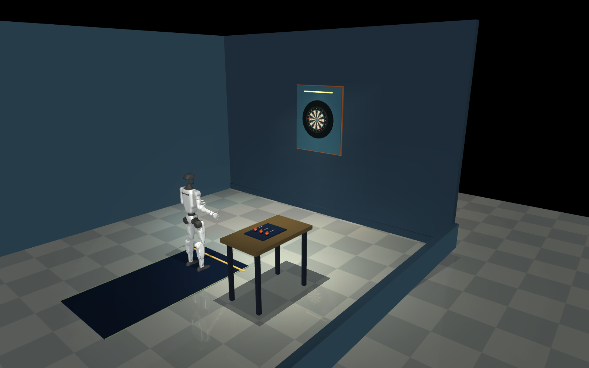
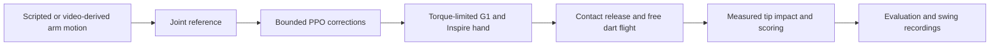

# G1 Darts Lab

**A simulated Unitree G1 learns to throw a free dart with a five-finger Inspire hand.**



[Watch a recorded bullseye](lab/progress_videos/12_ppo_bullseye_training_throw.mp4) ·
[Watch the first reproducible board hit](lab/experiment2/milestones/first_board_hit/swing.mp4) ·
[Watch the five-finger grip and release](lab/inspire_grip/left_hand_hold_release.mp4)

## Results at a glance

| Experiment | What we built | What the evidence shows |
| --- | --- | --- |
| [1 · Scripted swing](lab/experiment1/27_featured_wrist_snap/swing.mp4) | Shoulder, elbow and wrist motion with timed hand opening | The scripted baseline supplied the prior for Experiment 2. |
| [2 · PPO throwing](lab/experiment2/README.md) | Calibrated reference and bounded corrections, scored by simulated contact | Four checkpoints tested on 128 held-out throws each achieved 112–120 board hits and 5–13 inner bulls per checkpoint. |
| [3 · Tabletop pickup](lab/experiment3/README.md) | HaMeR-guided arm rehearsal, a fitted contact controller and residual PPO | One nominal policy rollout lifted the dart about 99 mm. Pickup reliability remains unverified. |
| [4 · Video-guided throw](lab/experiment4/README.md) | GVHMR reconstruction, two-swing arm retargeting and residual PPO | The fitted motion preserved both pullbacks and released cleanly at two simulation timesteps. Initial PPO validation yielded 57/64 clean releases and 0/64 board hits. |

The **1.17 mm** bullseye in the featured clip is one training rollout. See the
[held-out comparison](lab/experiment2/analysis/extension_holdout_20261103/comparison.json)
for board hits, inner bulls, collision counts and target error across checkpoints.
All results use a supported robot in MuJoCo.

## How it works



The dart weighs 26.7 g. Finger contacts hold it until the hand opens.
After release, gravity and modeled aerodynamic loads govern the free flight.
The scoring check requires valid release and a tip-first board impact
within **6.35 mm** of center for an inner bull. See the
[dart model and validation](lab/DART_PHYSICS.md).

## Run the simulator

From the repository root with Python 3.10 or newer:

```sh
cd lab
python -m pip install -r requirements.txt
python view_scene.py
```

The room starts paused. Press **1–5** to switch cameras, **Space** to toggle
physics, **R** to reset, or **F** for the free camera. Use
`python inspire_grip.py` for the supported five-finger demo.

```sh
python -m pip install -r experiment2/requirements.txt
python experiment2/replay_board_hit.py --verify-only
```

Run the replay from the same `lab/` directory. It simulates the archived calibrated throw using its checkpoint,
normalizer, configuration and seed. It checks the impact against the saved result.
The [board-hit bundle](lab/experiment2/milestones/first_board_hit/README.md) explains the test.

## Browse the project

| Area | Contents |
| --- | --- |
| [Simulator](lab/) | Scene, dart physics, grip demos, and shared robot assets |
| [Throwing PPO](lab/experiment2/) | Training and evaluation code, checkpoint bundles, and holdout results |
| [Tabletop pickup](lab/experiment3/) | Hand reconstruction, arm retargeting, and pickup experiments |
| [Video-guided throwing](lab/experiment4/) | Two-swing reference extraction, retargeting, and physical validation |
| [Demo footage](lab/progress_videos/) | Selected simulation and reconstruction videos |

## More footage

[Room tour](lab/progress_videos/01_room_and_environment.mp4) ·
[Two-finger hold and drop](lab/progress_videos/03_physical_hold_and_release.mp4) ·
[HaMeR hand reconstruction](lab/progress_videos/06_hamer_full_3d_hand.mp4) ·
[G1 arm rehearsal](lab/progress_videos/10_g1_hamer_guided_arm_rehearsal.mp4) ·
[Pickup timestep comparison](lab/progress_videos/13_pickup_timestep_comparison.mp4)

Project code is [MIT licensed](LICENSE). See the separate
[Unitree G1](lab/assets/g1/LICENSE) and [Inspire hand](lab/assets/inspire/LICENSE)
asset notices and the [video source catalog](lab/video_dataset/README.md).
