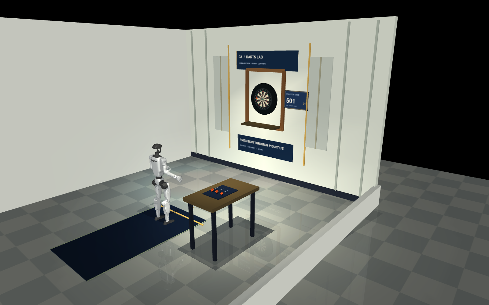
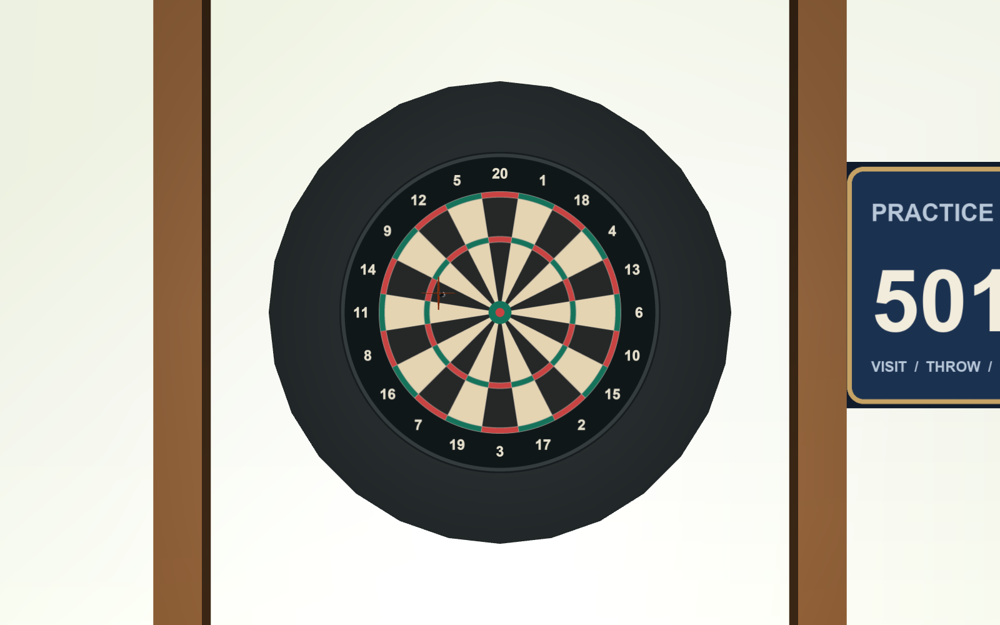

# G1 Darts Lab

Standalone MuJoCo environment: G1, open inspection room, illuminated dartboard,
marked throwing lane, side equipment table, three spare darts, and one display dart.

The bull is 1.73 m above the floor. The throwing line is 2.37 m from the board face.
Board texture includes the standard sector order, doubles, trebles, and both bulls.
The scene has named bull, board-frame, oche, dart-tip, and dart-grip sites for later training.

## Progress — 28 October 2026

The supported G1 can hold the 26.7 g dart tip-down through finger contact and
release it by opening a powered two-finger gripper. Arm targets and grip force
are editable in the control panel. The 10-second hold and gravity-drop checks
pass. See [PROGRESS.md](PROGRESS.md) for measurements, selected video data, and
the remaining milestones.

- [Room and environment tour (23 s)](progress_videos/01_room_and_environment.mp4)
- [Joint sliders and grip controls (25 s)](progress_videos/02_joint_and_grip_controls.mp4)
- [Physical hold and gravity release (17 s)](progress_videos/03_physical_hold_and_release.mp4)

## Open

From the `hackathon` repository folder in PowerShell:

```powershell
python -m pip install -r requirements.txt
python view_scene.py
```

The viewer starts paused at an inspection pose. Press **1–5** for room, board,
robot, side, and dart cameras; **Space** toggles physics; **R** restores the scene.
Press **F** for a free camera, then use the MuJoCo mouse controls to orbit and zoom.
The existing robot has rigid hands and no balance controller, so it falls when
uncontrolled physics runs. Standing control and finger release are later tasks.

For the new supported **grip-and-release demo**, run `python grip_demo.py`.
It opens an arm-joint editor and an actuated two-finger gripper: **O** opens and
drops the dart, **C** closes, **R** reloads, and **D** runs a hold/drop cycle.
The dart is held through contact friction. See [GRIP_DEMO.md](GRIP_DEMO.md) for
controls, the physics checks, and the distinction from a calibrated dexterous hand.

## Rebuild and check

```powershell
python build_scene.py
python check_scene.py
python validate_dart.py
python view_scene.py --render
```

`scene.xml` and its copied G1 meshes can be loaded directly in MuJoCo. The scene
builder reuses bundled robot assets when the original workspace is absent, so the
repository builds on its own. It creates the procedural textures as part of a rebuild.
Python 3.10 or newer is recommended. Dependencies are in `requirements.txt`.

## Current physical scope

- Room, table, board backing, robot, and dart geometry have collision shapes.
- `spare_dart_1` is a free rigid body. The scene darts use the measured reference
  assembly from James and Potts: 26.7 ± 0.2 g total, 24.9 g metal assembly,
  1.8 g stem and flight assembly, and center of mass 48.5 mm behind the tip.
  The profile also records the measured barrel, stem, and flight dimensions.
- The reference reports an 80% tungsten barrel and nylon stem. The exact metal
  composition, point dimensions, and flight sheet material are unavailable; those
  are marked as assumed or reconstructed in `dart_profile.json`.
- `dart_model.py` builds detailed collision geometry, applies the measured mass
  and center of mass, and computes inertia. Its transverse inertia is inferred
  from the paper's analytical stability derivative. The aerodynamic model is an explicit force/torque routine:
  a training loop must call `DartDynamics.step(data)` for air loads to be applied.
- The viewer's Space toggle applies those dart air loads through the same
  `DartDynamics.step(data)` needed in training. Loading the XML alone in a generic
  viewer omits custom air loads. Drag, friction, contact, and board interaction
  remain approximations; no sim-to-real accuracy has been established.
- See [DART_PHYSICS.md](DART_PHYSICS.md) for provenance, numerical checks,
  randomization, and calibration requirements. `assets/dart.xml` exports the same
  asset in isolation for controller and flight tests.
- The room inspection model has rigid hands. The separate supported grip demo
  implements contact-based release with a custom two-finger gripper. Throwing,
  a calibrated dexterous hand, balance control, and scoring remain pending.
- The near-side wall and ceiling are open for camera visibility.

Sources: [PDC board setup](https://www.pdc-europe.tv/wiki/rules/),
[experimental dart-flight study](https://doi.org/10.1007/s12283-018-0279-9).
The G1 collision and rendering meshes are distributed under Unitree's BSD 3-Clause
license, included in `assets/g1/LICENSE`. The project code is under the root MIT
license. Keep the two notices with their respective files.

## Previews




